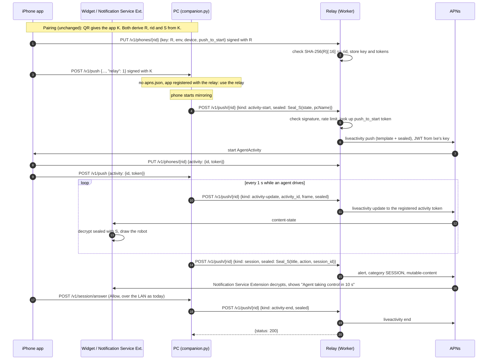

# Push relay (design proposal)

Status: proposal, nothing built. It answers the "Push notifications need a relay" item in
[PACKAGING.md](PACKAGING.md).

## The problem

The PC signs its own APNs requests (`phoneuse/apns.py`) with `~/.config/phoneuse/apns.json` and an
`AuthKey_*.p8` from lxe's Apple developer team. Only lxe's PC has that key, and it can't ship inside the Mac DMG
or the Flatpak: anyone who unpacked it could push anything to every Phone Use install. So on released copies
`apns.configured()` is false and every push in `companion.py` is skipped:

| Push | Sent by | APNs topic and type | What the owner loses without it |
|---|---|---|---|
| Live Activity start | `_send_activity` | `co.lxe.phoneuse.push-type.liveactivity`, `liveactivity` | The robot doesn't appear unless the app is opened while mirroring |
| Live Activity update and end | `_send_activity`, every 1 s while driving | same | The activity freezes; Take over still works, the state it shows is stale |
| Session request | `push_session` | `co.lxe.phoneuse`, `alert` | No Allow/Deny prompt while the app is closed |
| Unlock request | `push_unlock` | same, `alert` | No Unlock/Deny prompt |
| Request over | `push_request_over` | same, `background` | Stale request notifications stay on the lock screen |

The app still works when it's open, because it reads `GET /v1/state` over the LAN. Everything that has to
reach a phone in a pocket goes through APNs, and APNs only accepts pushes for `co.lxe.phoneuse` signed with a
key from team `9592R2Q8PP`.

## Recommendation

Run a small relay on **Cloudflare Workers** (with Workers KV) that holds the APNs key as a Worker secret.

- **Authorization.** The app registers its push tokens with the relay itself, under an id and a secret that
  both sides derive from the pairing key. The PC signs each push request with that secret, and names a token
  *slot* (device, push-to-start, or the current activity) instead of a token. The relay therefore pushes only to
  tokens the app registered, and only for a PC that holds that pairing's key.
- **Privacy.** The PC seals every payload's content with a key derived from the pairing key. The relay builds
  the APNs payload from fixed templates and never sees agent actions, step counts, request ids, or the PC's
  name. The widget decrypts the Live Activity state when it renders, and a new Notification Service Extension
  decrypts alerts.
- **Cost.** lxe's own use fits Cloudflare's free plan (100,000 requests a day). Opening it to the public moves
  to Workers Paid at **$5 a month**, which covers roughly 40 heavy users before overage, then about **$0.07 per
  heavy user per month** (estimate below). APNs itself is free.
- **Migration.** Direct pushes stay for any PC that has `apns.json` (lxe's machine, people who build the app
  under their own team). Released PCs use the relay once the paired app reports that it registered there.

One thing needs a spike before committing: APNs requires HTTP/2, and whether a Worker's `fetch()` to
`api.push.apple.com` negotiates it has to be tested. The existence of a Workers-targeted APNs client
([@fivesheepco/cloudflare-apns2](https://npmjs.com/package/@fivesheepco/cloudflare-apns2)) suggests it does.
If it doesn't, option B below (a small VM) is the fallback, and the protocol in this doc doesn't change.

## Keys and ids

Everything comes from the 32-byte pairing key `K` the app and PC already share, with HKDF-SHA256 (salt empty,
32 bytes), the same way `companion._seal_key` derives `"phoneuse seal"`:

| Name | Derivation | Who knows it |
|---|---|---|
| Relay key `R` | HKDF(K, info `"phoneuse relay"`) | app, PC, relay |
| Relay id `rid` | first 16 bytes of SHA-256(R), hex | app, PC, relay |
| Push seal key `S` | HKDF(K, info `"phoneuse push seal"`) | app (and its extensions), PC |

The relay learns `R` but can't get `K` or `S` from it, so it can authenticate pushes without being able to
read them. Because `rid` is a hash of `R`, the relay can check at first registration that the id and the key
belong together, and nobody can claim an id without the key. No new step is added to pairing: both sides
compute these values from the key they already have, and a new pairing gives a new `rid`.

Each pairing is one PC and one phone, so a PC with two paired phones has two `rid`s and sends each push twice,
as it loops over `devices` today.

## Relay API

Base URL: `https://push.lxe.co` (or a `workers.dev` name, see open questions). Requests carry the same
`X-PU-Time`, `X-PU-Nonce` and `X-PU-Sig` headers as the companion API ([COMPANION.md](COMPANION.md), "Signing
requests"), keyed with `R` instead of `K`. The relay refuses a request more than 60 s off.

### `PUT /v1/phones/{rid}` (the app)

```json
{"key": "<R, base64url; only on the first registration>",
 "bundle_id": "co.lxe.phoneuse", "env": "sandbox | production",
 "device": "<hex>", "push_to_start": "<hex>", "activity": {"id": "…", "token": "<hex>"}}
```

The fields mirror the app's `POST /v1/push` to the PC. If the relay doesn't know `rid`, it requires `key`,
checks `SHA-256(key)[:16] == rid` and the signature, and stores the key. Later registrations must not carry
`key`; they are only checked against the stored one. The relay accepts only bundle id `co.lxe.phoneuse` and
skips the KV write when nothing changed, because the app re-sends all its tokens every time it becomes active.
A registration that isn't refreshed for 30 days expires.

### `DELETE /v1/phones/{rid}` (the app or the PC)

Forgets the registration. The app calls it when it unpairs, next to `DELETE /v1/pairing`, and the PC calls it on
`phoneuse app unpair`.

### `POST /v1/push/{rid}` (the PC)

```json
{"kind": "activity-start | activity-update | activity-end | session | unlock | request-over",
 "activity_id": "…",
 "timestamp": 1762700000, "dismissal_date": 1762700010, "priority": 10,
 "frame": 41, "updated_at": 1762700000.25,
 "sealed": "<base64 of nonce(12) | ciphertext | tag(16)>"}
```

`kind` picks the APNs topic, push type, token slot and payload template. The PC never sends a token, so it can
only reach the slots the app registered. For activity updates, `activity_id` must match the registered activity,
so a PC that missed a new activity can't push to an old token. The relay answers with APNs's result,
`{"status": 200}` or `{"status": 410, "reason": "Unregistered"}`, and drops a token that APNs reports gone, so
the PC keeps its current logic for forgetting an ended activity.

The relay also handles the `BadDeviceToken` retry against the other APNs environment that `_send` does today,
and remembers the environment per slot.

### Payload templates

The relay fills in only fixed text and the few plain fields above:

| `kind` | APNs payload the relay sends |
|---|---|
| `activity-start` | `event: "start"`, `attributes-type: "AgentActivityAttributes"`, `attributes: {"pcName": "", "sealed": …}`, `content-state: {"sealed": …, "frame", "updatedAt"}`, `alert: {"title": "Phone Use", "body": "Mirroring to your computer"}` |
| `activity-update` | `event: "update"`, the same `content-state`; with an `alert` ("Phone Use", "An agent asks to use your iPhone") when the PC flags `"alert": true` |
| `activity-end` | `event: "end"`, the same `content-state`, `dismissal-date` |
| `session` | `alert: {"title": "Phone Use", "body": "An agent asks to use your iPhone"}`, `category: "SESSION"`, `interruption-level: "time-sensitive"`, `mutable-content: 1`, `sealed` |
| `unlock` | `alert: {"title": "Unlock the iPhone?", "body": "An agent asks to enter your saved passcode."}`, `category: "UNLOCK"`, `mutable-content: 1`, `sealed` |
| `request-over` | `content-available: 1`, priority 5, `sealed` |

Templates keep lxe's key from carrying arbitrary text: a modified PC can push to its own phone only, and only
these notifications.

## Payload privacy

The relay sees the `rid`, the kind of push, when it's sent, the `frame` counter and its size. That tells it
when an agent is working on someone's phone and for how long, but nothing about what the agent does. The
relay keeps no log of request bodies; its logs hold `rid`, kind, APNs status and time.

Everything else goes in `sealed`: AES-256-GCM with key `S`, the `kind` as associated data, a fresh 12-byte
nonce, the same format as the companion API's sealed secrets.

- **Live Activity.** iOS decodes `content-state` into `AgentActivityAttributes.ContentState` without running any
  app code, so it can't be decrypted on arrival. The widget's views do run app code, though, and the widget
  extension already has the pairing key (`Pairing.swift` and `CompanionCrypto.swift` are in its sources, and the
  key is in the shared Keychain). `ContentState` gains an optional `sealed` field. When it's present, the
  widget decrypts it into the existing fields (`state`, `phase`, `action`, `steps`, `requestId`, `deadline`,
  `detail`, `startedAt`) at render time. `frame` and `updatedAt` stay plain because they're what make each 1 s
  refresh new content, and they reveal nothing. The `pcName` attribute is sealed the same way. Decrypting a
  few hundred bytes per render is cheap, but the spike should measure it on a real Dynamic Island.
- **Alerts.** A new Notification Service Extension target receives `session` and `unlock` pushes (they have
  `mutable-content: 1`), decrypts `sealed`, and replaces the generic title and body with the PC's text ("Agent
  taking control in 10 s", the action), and puts `session_id` or `unlock_id` into `userInfo`. The existing
  Allow, Deny and Unlock actions then work unchanged. If decryption fails, the owner sees the generic text,
  and tapping it opens the app, which shows the request from `GET /v1/state`.
- **Request over.** The app's `didReceiveRemoteNotification` decrypts `sealed` to get `{kind, id}`.
- **System-drawn alerts** (the Live Activity start and the `asking` update) can't be decrypted, so they use
  the fixed text above.

A relay could replay an old sealed state to the activity. That costs the owner a wrong picture for at most a
second, since the PC's next refresh overwrites it, and the sealed content carries `updatedAt`, so the widget
can ignore a state older than the one it shows.

## Rate limits and abuse

Apple sets its own limits (a Live Activity update budget, raised by `NSSupportsLiveActivitiesFrequentUpdates`,
and a `TooManyProviderTokenUpdates` error if the signing JWT changes more often than every 20 minutes). The
relay adds its own so one broken or hostile PC can't get lxe's key throttled or revoked:

| What | Limit per `rid` |
|---|---|
| `activity-update` | 2 a second burst, 1 a second sustained (the PC's own cap) |
| `activity-start` | 6 an hour (the PC tries at most once every 10 minutes) |
| `session`, `unlock` | 60 an hour |
| `request-over` | 120 an hour |
| everything | 20,000 a day |

Other guards:

- **Unknown `rid` or bad signature:** 401 before any KV read beyond the key lookup and before any APNs call.
- **Registrations:** at most 20 an hour per IP address; `rid` must match `key`.
- **Body size:** 2 KB for `sealed`, so the payload stays under APNs's 4 KB limit.
- **Replays:** the 60 s clock window bounds them. Workers KV is eventually consistent, so a strict nonce check
  would need a Durable Object; a replay within the window only re-sends the same push to the same phone, and
  the rate limits above cap that, so the window is enough to start.
- **Kill switches:** a Worker variable that stops all pushes, and a KV block list of `rid`s.
- **Possible later:** App Attest on registration, so only the genuine app can register (see open questions).

The counters use the Workers rate limiting binding, whose counts are per Cloudflare location and approximate.
That's enough here, because one PC talks to one location.

The JWT that authenticates the relay to APNs is cached in each isolate for 50 minutes, like `apns._token`. So
that many isolates don't each mint their own and trip `TooManyProviderTokenUpdates`, the relay keeps one
current JWT in KV and mints a new one only when that one is older than 40 minutes.

## Sequence



## Where it runs and what it costs

### Volume

The 1 s Live Activity refresh dominates: one push per second per phone while an agent drives, so an hour of
agent work is about 3,600 relay requests. Everything else (starts, requests, ends) adds a few dozen a day.

| User | Agent time | Relay requests per month |
|---|---|---|
| lxe | ~3 h a day | ~330,000 (~11,000 a day) |
| A heavy user | ~2 h a day | ~220,000 |
| A typical user | ~2 h a week | ~30,000 |

### Options

| Option | Cost | Notes |
|---|---|---|
| **A. Cloudflare Workers + KV (recommended)** | Free plan: $0 up to 100,000 requests a day and 1,000 KV writes a day, which covers lxe and a handful of testers. Workers Paid: $5 a month including 10 M requests, then $0.30 per million, so ~$0.07 per heavy user a month beyond ~40 of them. | No server to patch; the key is a Worker secret only lxe sets with `wrangler secret put`. CPU per request is an HMAC check and filling in a template, well under the free plan's 10 ms. HTTP/2 to APNs needs the spike. R2 isn't needed: there are no files to store. |
| B. A small VM (Fly.io, Hetzner) running a Python relay | ~$4–6 a month flat | Reuses `apns.py` and keeps one HTTP/2 connection open, as Apple recommends. lxe has to patch it and keep it up. The fallback if A's spike fails. |
| C. AWS Lambda + API Gateway | ~$1–3 a month at this volume | Same shape as A with more setup and no advantage for lxe. |
| D. A push service such as Firebase Cloud Messaging | Free | Firebase still needs the APNs key uploaded, and each PC would need Firebase server credentials, which leaves the same shipping problem. |
| E. Bring your own key only | $0 | Today's behaviour. Kept for developers, but released copies would never get pushes. |

Prices are Cloudflare's published Workers and KV prices as of 2026; check them before deciding. If the relay's
volume ever matters, the PC can stretch the driving heartbeat from 1 s to 2–3 s in relay mode, which halves or
thirds the request count at the cost of a choppier animation.

### Key custody

Create a **new APNs key** for the relay instead of reusing the one on lxe's PC, so either can be revoked on its
own. If Apple's key settings allow restricting a key to one topic or environment, restrict it to
`co.lxe.phoneuse`. Only lxe enters the key, with `wrangler secret put APNS_KEY` from their own machine; it never
goes into the repo, CI or a chat.

## Migration

The PC gets one setting, `push` in `config.yaml`: `auto` (the default), `direct`, `relay` or `off`.

- **`auto`:** direct pushes if `apns.json` exists, as today. Otherwise the relay, for each phone whose app said
  it registered there. Otherwise no pushes, as released copies behave now.
- **The app tells the PC.** `POST /v1/push` gains `"relay": 1`, meaning "I registered with the relay and I can
  read sealed payloads". That flag guards both changes at once, so the PC never sends sealed content to an app
  that can't open it, and never uses the relay for a phone the relay doesn't know.

Order of work:

1. **Spike.** A Worker that signs a JWT and sends one sandbox push to a development build, to confirm HTTP/2,
   and a widget build that decrypts a sealed `content-state` on a real Dynamic Island.
2. **Relay.** The Worker with the three endpoints, templates, rate limits and KV, deployed to a sandbox-only
   name first.
3. **App.** Relay registration in `PushRegistrar` (same triggers as `resendAll`), `sealed` in `ContentState`
   and `AgentActivityAttributes`, the Notification Service Extension (a new target in `project.yml`, sharing
   the Keychain access group with the app and widget), `DELETE` on unpair, and `"relay": 1`. Ships as a new
   TestFlight build.
4. **PC.** A `relay.py` next to `apns.py` with the same `send()` shape, so `_send` picks one or the other and
   the push logic in `companion.py` stays as it is. Sealing happens in the callers, which build the
   `content-state` and alert text today.
5. **Dogfood.** lxe switches their own PC to `push: relay` for a week, with the direct path as the fallback.
6. **Release.** A Mac DMG and Flatpak with `auto`. Old apps paired to a new PC get no pushes, as now; a new app
   paired to an old PC registers with the relay harmlessly.

Direct pushes stay permanently: someone who builds the app under their own team and bundle id can't use lxe's
relay, which accepts only `co.lxe.phoneuse`, and needs their own key as today.

## Open questions

1. **HTTP/2 from Workers.** Does `fetch()` to `api.push.apple.com` work from a Worker? The spike decides between
   options A and B.
2. **Hostname.** Is lxe.co's DNS on Cloudflare, so the relay can live at `push.lxe.co`? If not, a `workers.dev`
   name works, but it's baked into released apps and PCs, so it should be chosen once.
3. **Widget decryption.** Does reading the Keychain and decrypting in the widget's render path work reliably on
   the lock screen while the phone is locked? The Keychain item's accessibility class may need to be
   `afterFirstUnlock`.
4. **App group.** `project.yml` still has the app group commented out. The Notification Service Extension needs
   the same Keychain access group as the app; does the current provisioning already allow that?
5. **App Attest.** Should registration require App Attest, so only the real app can register? It adds an
   Apple-verification step to the Worker; the `rid`/key binding may be enough at this scale.
6. **Free or Paid.** Start on the free plan and move to Paid when the app is public, or start on Paid for the
   higher limits and the absence of daily caps?
7. **What the relay may log.** The proposal keeps `rid`, kind, status and time for 7 days. Is that the right
   amount, and should the app's privacy text mention it?
8. **Plain fields.** Should the activity's `state` stay plain, so iOS's default rendering (and the
   `asking` alert's timing) works even when decryption fails, at the cost of the relay seeing when the owner is
   asked and when they take over?
