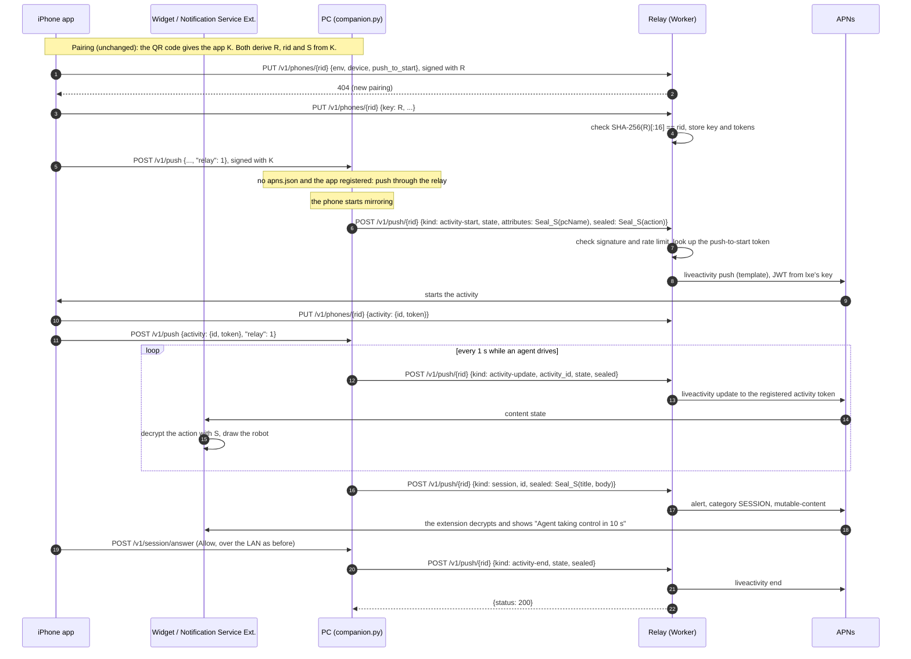

# Push relay

Released copies of Phone Use (the Mac DMG, the Flatpak) send Apple push notifications to the companion app
through a relay that holds the APNs key, because the key can't ship inside them. The relay is a Cloudflare
Worker at `https://phoneuse-push.lxe.workers.dev`; its code is in [`relay/`](../relay). The PC's side is
`phoneuse/relay.py`, and the app's side is `ios/Shared/PushRelay.swift`.

## Why

The PC used to sign every APNs request itself (`phoneuse/apns.py`) with `~/.config/phoneuse/apns.json` and an
`AuthKey_*.p8` from lxe's Apple developer team. APNs accepts pushes for `co.lxe.phoneuse` only when they're
signed with a key from that team, and anyone who unpacked a download containing the key could push anything to
every Phone Use install. So without the relay, released copies send no pushes at all:

| Push | Sent by | What the owner loses without it |
|---|---|---|
| Live Activity start | `_send_activity` | The robot doesn't appear unless the app is opened while mirroring |
| Live Activity update and end | `_send_activity`, every 1 s while driving | The activity freezes on stale state |
| Session request | `push_session` | No Allow/Deny prompt; with "After a delay", the agent takes the phone unseen |
| Unlock request | `push_unlock` | No Unlock/Deny prompt |
| Request over | `push_request_over` | Answered request notifications stay on the lock screen |

The app still works while it's open, because it reads `GET /v1/state` over the LAN. Anything that has to reach
a phone in a pocket goes through APNs, since iOS suspends the app soon after it leaves the screen.

## How a PC picks a path

`push` in `config.toml`:

- **`auto`** (the default): this PC's own key when `apns.json` exists, as before. Otherwise the relay, for each
  paired app that told the PC it registered there. Otherwise no pushes.
- **`direct`**, **`relay`** or **`off`** force one path.

The app tells the PC with `"relay": 1` in `POST /v1/push` (docs/COMPANION.md, "Push"), sent only after the
relay accepted its tokens. An app too old to register never sends it, so the PC never uses the relay for a phone
the relay doesn't know. Direct pushes stay for anyone who builds the app under their own team and bundle id:
the relay serves `co.lxe.phoneuse` only.

## Keys and ids

Everything comes from the 32-byte pairing key `K` the app and PC already share, with HKDF-SHA256 (salt empty,
32 bytes), the same way `companion._seal_key` derives `"phoneuse seal"`:

| Name | Derivation | Who knows it |
|---|---|---|
| Relay key `R` | HKDF(K, info `"phoneuse relay"`) | app, PC, relay |
| Relay id `rid` | first 16 bytes of SHA-256(R), hex | app, PC, relay |
| Push seal key `S` | HKDF(K, info `"phoneuse push seal"`) | app (and its extensions), PC |

The relay learns `R`, but it can't get `K` or `S` from it, so it can check who's pushing without being able
to read what's sealed. Because `rid` is a hash of `R`, the relay checks at the first registration that the id
and the key belong together, so nobody can claim an id without the key. Pairing itself is unchanged: both sides
compute these values from the key they already have, and a new pairing gives a new `rid`. A PC with two paired
phones has two `rid`s.

`ios/Tests/CompanionCryptoTests.swift` checks the Swift derivation and sealing against values from
`relay.py`.

## Relay API

Requests carry the companion API's `X-PU-Time`, `X-PU-Nonce` and `X-PU-Sig` headers (docs/COMPANION.md,
"Signing requests"), keyed with `R`. The relay refuses a request whose time is more than 60 s off.

### `PUT /v1/phones/{rid}` (the app)

```json
{"key": "<R, base64url; only when the relay answered 404>",
 "bundle_id": "co.lxe.phoneuse", "env": "sandbox | production",
 "device": "<hex>", "push_to_start": "<hex>", "activity": {"id": "…", "token": "<hex>"}}
```

The app sends the same fields as its `POST /v1/push` to the PC, every time it sends those. The first
registration of a pairing gets 404, and the app sends it again with `key`. The relay checks
`SHA-256(key)[:16] == rid` and the signature before it stores the key; later registrations are checked against
the stored key. The relay writes to KV only when something changed, or once a week, and a registration that
isn't refreshed for 30 days expires.

### `DELETE /v1/phones/{rid}` (the app or the PC)

Forgets the registration. The app calls it when it unpairs, after `DELETE /v1/pairing`. The PC calls it when it
forgets an app that had registered (`phoneuse app unpair`, or the app unpairing itself).

### `POST /v1/push/{rid}` (the PC)

```json
{"kind": "activity-start | activity-update | activity-end | session | unlock | request-over",
 "activity_id": "…", "timestamp": 1762700000, "dismissal_date": 1762700010,
 "state": {"state": "driving", "phase": "acting", "steps": 12, "requestId": "", "deadline": null,
           "startedAt": 1762699000, "updatedAt": 1762700000.25, "frame": 41},
 "attributes": "<sealed {pcName}>", "alert": "ask | warning",
 "id": "<session or unlock request id>", "over": "session | unlock",
 "sealed": "<base64 of nonce(12) | ciphertext | tag(16)>"}
```

Each kind uses only its own fields. `kind` picks the APNs topic, push type, token slot and payload template. The
PC never sends a token, so it can only reach the tokens the app registered; for activity updates and ends,
`activity_id` must name the registered activity. The relay answers `{"status", "reason"}` with APNs's result,
or with 410 `NoActivity` or `NoToken` when it has no such token. It drops a token APNs reports gone, and the
activity's token after an end, so the PC's existing handling of ended activities works unchanged. Like the
PC's direct path, it retries a `BadDeviceToken` in the other APNs environment and remembers which one worked.

`phoneuse/relay.py` builds this body from the same APNs payload `companion.py` builds for the direct path, so
the push logic in `companion.py` is shared by both.

### What the relay sends to APNs

| `kind` | Payload |
|---|---|
| `activity-start` | `event: "start"`, `attributes: {"pcName": "", "sealed"}`, the content state, and the alert "Phone Use" / "Mirroring to your computer" |
| `activity-update` | `event: "update"`, the content state; with `alert: "ask"` or `"warning"`, a fixed alert ("An agent asks to use your iPhone", "Phone Use needs your attention") |
| `activity-end` | `event: "end"`, the content state, `dismissal-date` |
| `session` | the alert "Phone Use" / "An agent asks to use your iPhone", category `SESSION`, time-sensitive, `mutable-content: 1`, `session_id`, `sealed` |
| `unlock` | the alert "Unlock the iPhone?" / "An agent asks to enter your saved passcode.", category `UNLOCK`, `mutable-content: 1`, `unlock_id`, `sealed` |
| `request-over` | `content-available: 1`, priority 5, `request_over: {kind, id}` |

The content state is the plain `state` fields, type-checked, plus `sealed`. Because the relay fills in fixed
text, a modified PC can use lxe's key only to send these notifications, and only to its own phone.

## Payload privacy

The relay never sees what an agent does. The agent's action, a bridge warning's text, the PC's own alert text
("Agent taking control in 10 s") and the PC's name are sealed with `S` (AES-256-GCM, a fresh 12-byte nonce,
associated data `activity`, `attributes` or `alert`).

These fields stay plain, because the app needs them even when it can't decrypt: the activity's `state`,
`phase`, step count, `requestId`, `deadline`, `startedAt`, `updatedAt` and `frame`, and the session and unlock
request ids. With them, the robot moves and Allow, Deny, Unlock and Take over work in every case. They tell the
relay when an agent works on someone's phone, for how long and in how many steps, which the push timing shows
anyway. Request ids are random and mean nothing outside the PC.

On the phone:

- **Live Activity.** `AgentActivityAttributes.ContentState` and the attributes decrypt `sealed` while they
  decode, which runs in the widget extension and the app.
- **Alerts.** A Notification Service Extension (`ios/NotificationService/`) replaces the fixed title and body
  with the sealed ones.
- **Without the key.** Both read the pairing key from the Keychain. An extension can only do that through the
  app group's keychain access group, which isn't enabled yet (`project.yml`). Until it is, the widget shows the
  state without the action text, and alerts show the fixed text. Everything else works.

The relay logs the first 8 characters of the `rid`, the kind and the APNs status of each push (Workers logs),
and no payloads.

## Limits and abuse

| What | Limit |
|---|---|
| Live Activity pushes per `rid` | 120 a minute (the PC sends at most 1 a second) |
| Session, unlock and request-over pushes per `rid` | 20 a minute |
| Registrations per IP address | 30 a minute |
| Request body | 8 KB; `sealed` 2 KB |

Other guards:

- An unknown `rid` or a bad signature is refused before any APNs call.
- Replays are bounded by the 60 s clock window. A replay can only re-send the same push to the same phone, and
  the rate limits cap that, so the relay keeps no nonce list (KV is eventually consistent, so a strict one would
  need a Durable Object).
- `PAUSED` (a Worker variable) stops every push; a KV key `block:<rid>` stops one pairing.
- The rate limiting binding counts per Cloudflare location, approximately. One PC talks to one location, so
  that's enough.
- One APNs JWT is shared by every isolate through KV and replaced every 40 minutes, because Apple refuses a key
  whose token changes more often than every 20 minutes (`TooManyProviderTokenUpdates`).

## Sequence



## Cost

The relay runs on Cloudflare's free plan: 100,000 Worker requests a day, 100,000 KV reads and 1,000 KV writes.
Every push is one Worker request and one KV read, and KV writes happen only when tokens change and every 40
minutes for the JWT. The 1 s Live Activity refresh dominates, at about 3,600 requests per hour of agent work,
so the free plan covers about 25 hours of agent work a day across all users. Past that, Workers Paid costs $5
a month for 10 million requests, then $0.30 per million. APNs is free. (Cloudflare's prices as of November
2026.)

The 1 s refresh is what keeps the robot moving: iOS doesn't animate timer views in the compact Dynamic Island,
so each push draws one animation frame. If the request count ever matters, relay mode can refresh every 2 s.

## Deploying the relay

See [relay/README.md](../relay/README.md).

## Open questions

1. **The app group.** Enabling `group.co.lxe.phoneuse` (commented out in `project.yml`) lets the widget and the
   Notification Service Extension read the pairing key, so the action text and the PC's alert text show.
2. **A key of its own.** The relay uses the same APNs key (`7CV9JYHX47`) as lxe's PC. A separate key would let
   either be revoked without the other.
3. **A hostname.** `phoneuse-push.lxe.workers.dev` is built into released apps and PCs. lxe.co isn't a zone
   in this Cloudflare account; if it moves there, `push.lxe.co` could be added as a second name, but the
   workers.dev name has to keep working for the builds that have it.
4. **App Attest.** Registration could require App Attest, so that only the genuine app can register. The
   `rid`/key binding seems enough at this scale.
